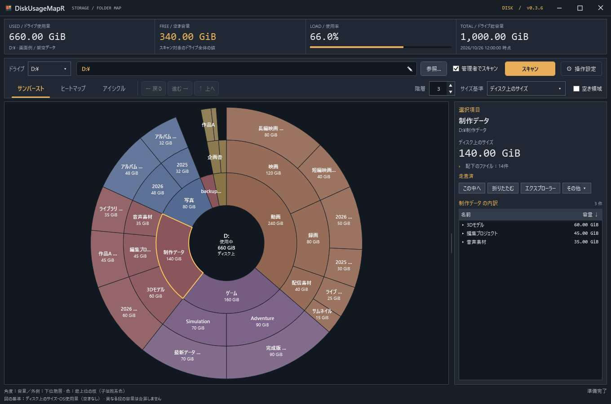
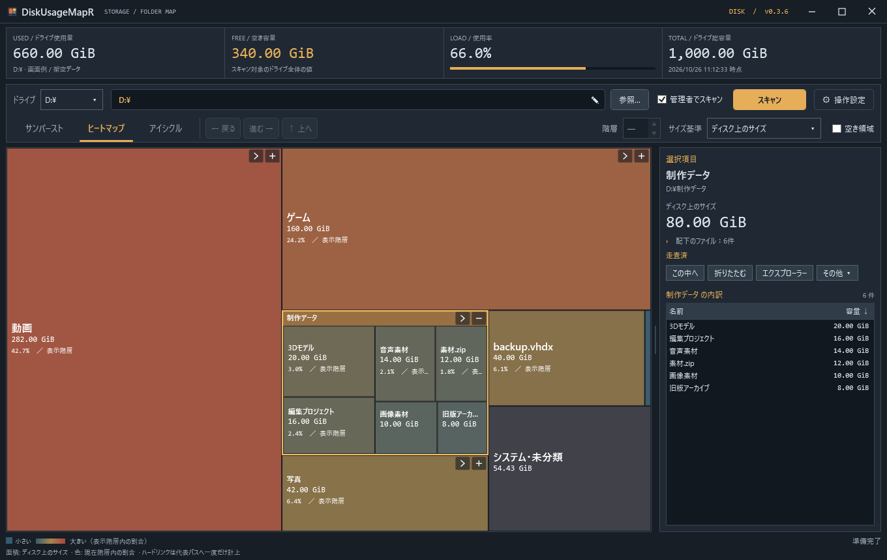
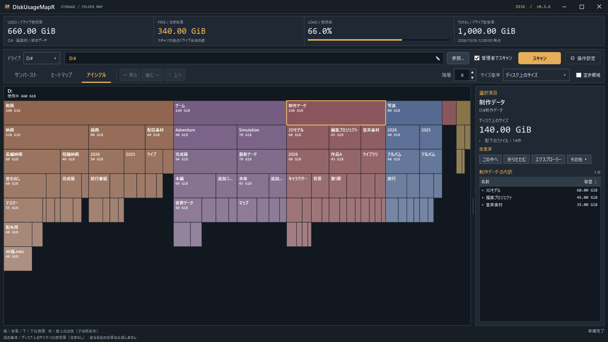
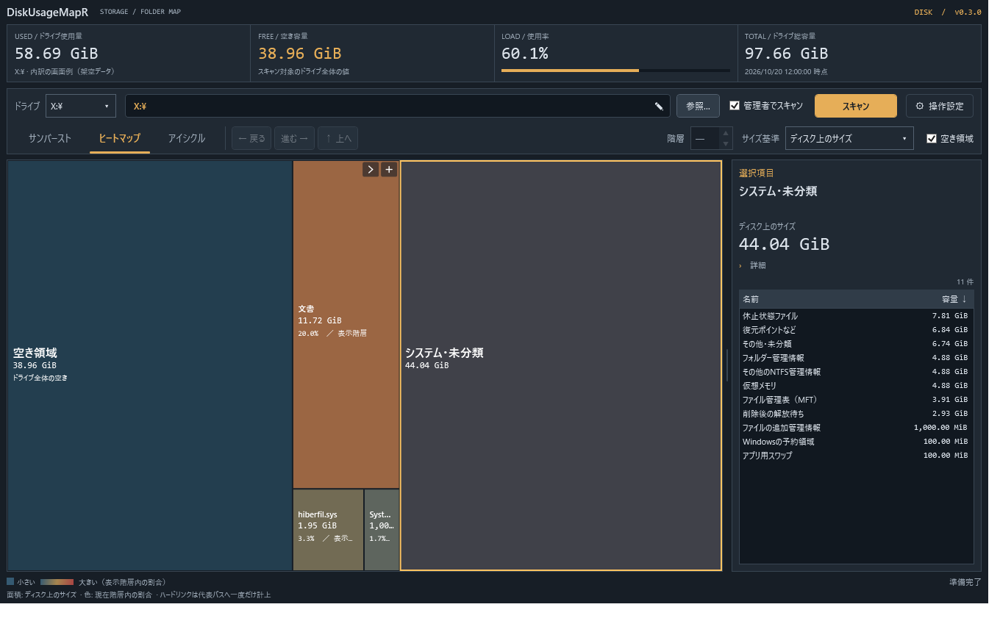

# DiskUsageMapR

ヒートマップ・アイシクル・サンバーストでディスク使用量を確認できるWindowsアプリです。画面では「ディスク使用量マップ」と案内します。フォルダーの奥へ進み、容量の大きい場所を調べられます。日本語UI・オフライン動作。

**[最新版をダウンロード](https://github.com/mezon-web/DiskUsageMapR-Releases/releases/latest)**

画面はすべて架空データです。

## 使い始める

1. Windows 11 x64で、**.NET 10 Desktop Runtime x64**を用意します。[Microsoftのダウンロードページ](https://dotnet.microsoft.com/ja-jp/download/dotnet/10.0) の「.NET Desktop Runtime」を選んでください。
2. [Releases](https://github.com/mezon-web/DiskUsageMapR-Releases/releases) の `DiskUsageMapR-v0.3.6.zip` をダウンロードして展開します。
3. 展開された `DiskUsageMapR-v0.3.6` フォルダー内の `DiskUsageMapR.exe` を起動し、フォルダーやドライブを選んで「スキャン」。エクスプローラーからフォルダーまたはドライブ1件をドロップしても開始できます。

ランタイム非同梱の単一EXEです。ZIPにはEXEと日本語の「使い方.html」が入っています。使い方は、基本の4ステップから読める一列のHTMLです。[使い方HTMLを単体で保存](https://github.com/mezon-web/DiskUsageMapR-Releases/raw/refs/heads/main/manual.html)して、オフラインでも読めます。インストーラーや常駐サービスはありません。

［管理者でスキャン］は起動時ONで、ローカル対象のスキャン開始時にUACの確認が出ます。通常権限で使う場合はOFFにしてください。ネットワーク先は通常権限で計測し、チェックを一時的に無効化します。画面と削除操作の権限は上げません。管理者スキャンは同じWindowsユーザーの昇格に対応します。

## できること

- ヒートマップ／アイシクル／サンバーストのタブで表示方式を切替。現在階層・選択・内訳を保ち、再スキャンせず切り替えられます。ヒートマップは大きい割合ほど暖色、新2方式は枝ごとに同系色で表示します。
- クリックで選択、右の内訳で直下のフォルダー・ファイルを確認。ファイル数の行から詳細を開けます。
- 一覧で選んだ項目が見えるところまで親フォルダーを自動で分割し、マップに選択を表示します。一覧の対象やスクロール位置は保ちます。
- 「中を見る」で階層移動。「分割／展開」で選んだ枝を開閉。ダブルクリックの初期値はヒートマップが分割、新2方式が「この中へ」です。
- アイシクルは初期10階層、サンバーストは初期3階層。メイン画面の［階層］から1～10段を選べ、方式ごとに独立して保存します。
- ［操作設定］に3方式すべてのダブルクリック動作と、新2方式それぞれの階層数を表示。現在選んでいない方式の設定も変更できます。
- 図と右の詳細欄の境界を左右にドラッグして、幅を調整できます。
- パンくず・戻る／進む・マウスのサイドボタンで移動し、選択・分割・内訳の対象を復元。
- 空き領域の表示切替、ディスク上のサイズ／通常のファイルサイズ切替。空き表示は初回OFFです。変更した設定は再起動後も引き継ぎます。
- 対応するローカル固定NTFSドライブ全体では、管理者スキャンでMFT方式を自動利用します。対象や取得状況に応じて理由を表示し、通常方式へ切り替えます。
- スキャン中も取得済みの情報を3方式で表示。選択・階層移動・展開・容量基準・表示方式・階層数・空き領域のON/OFF・場所を開く・中止を操作できます。削除はスキャン終了後に利用できます。
- 正常に取得できた項目は「走査済」、除外や失敗は「リンク除外 ○件 · 取得不可 ○件」のように表示します。
- 「システム・未分類」を選ぶと、取得できたシステム領域の内訳と説明を右側に表示します。
- エクスプローラーで開く、パスをコピー、ファイル・フォルダー1件を「ゴミ箱へ」「完全に削除」。フォルダーは配下も対象とし、パス・容量・件数を確認してから実行します。

完全削除はごみ箱から戻せません。一括削除、スキャン起点やドライブ自体の削除には対応しません。フォルダーの配下にあるジャンクション等は参照先に入らず、リンク自体だけを対象にします。途中失敗で一部が削除済みの場合は再スキャンを案内します。

スキャンはメタデータを調べ、読めない場所・未走査・リンクの除外を区別します。管理者でも全項目を読めるとは限りません。スキャン後の外部変更は、再スキャンで取得します。HDDや別PCでの速度改善率は未検証です。

## v0.3.6の改善

最大化ボタンを押せない問題と、灰色のボタンが重なる表示を修正しました。マウスで押した後に枠が残らず、キーボードで選んだときだけフォーカス枠を表示します。

## v0.3.5の改善

アプリ名の帯をタイトルバーに統合し、アイコンと最小化・最大化・閉じるボタンを一段にまとめました。帯の空き部分をドラッグして移動でき、ダブルクリックで最大化と元に戻す操作ができます。

## v0.3.4の改善

計測中にサンバースト／アイシクルの外側の項目を選んでも、右の内訳一覧が選択に追従します。システム・未分類の内訳や、完了後に引き継ぐファイル選択も整えました。計測中の小項目の操作、階層移動の案内、容量基準切替後の一覧選択も改善しています。

## v0.3.1の改善

サンバーストでは、細い項目の名前と容量も見やすく表示するようにしました。サンバーストとアイシクルの図中の容量は小数なしにし、全体の容量を示す見出しを「ドライブ全体」「使用中」「計測中」に整理しました。右側の詳細には正確な数値を表示します。

## v0.3.0の改善

旧名からアプリと配布物を改名しました。スキャン中も取得済みの範囲で階層移動・展開・容量切替・場所を開く操作ができます。サンバーストの文字表示を改善し、設定した階層数を表示上限にしました。初期表示はサンバースト、空き表示の初期値はOFFです。

旧版と同じフォルダーに `DiskHeatMap.settings.json` があり、新しい `DiskUsageMapR.settings.json` がまだない場合は設定を引き継ぎます。旧ファイルは残ります。別フォルダーへ展開する場合は、旧設定ファイルを新しいEXEの隣へコピーしてください。

## 3つの表示方式

アイシクルとサンバーストを追加しました。操作欄は2行にまとめ、上段にアドレス兼パンくず、下段に表示タブ・戻る／進む・階層数を配置しています。検索機能は削除しました。階層数とダブルクリック動作は方式ごとに設定できます。

3つの表示方式の画面例

[今回の変更と使い方](RELEASE.md)

## ネットワーク共有とフォルダー使用量

- `\\NAS\共有\フォルダー` の直接入力・フォルダー選択・ドロップで開始できます。割り当て済みネットワークドライブも選択一覧に表示します。
- Windowsの現在の共有接続を使って通常権限で走査します。認証不足の場合はエクスプローラーで接続してから再試行してください。資格情報はアプリへ保存しません。
- スキャン起点が途中のフォルダー、または全体容量を取得できない場合は、左に「フォルダー使用量」を表示し、右3項目は「—」にします。フォルダーの値は選択した容量基準に従います。
- 共有先頭で全体容量を取得できる場合は、ユーザーの容量制限を含む「共有先使用量（参考）」です。共有先のマップには空き枠・システム残差を作りません。
- 共有先の削除は「完全に削除」のみです。他の利用者にも影響し、Windowsのごみ箱には入りません。NAS側のごみ箱やスナップショット等はサーバー設定に従います。リンクを含むフォルダーや、操作前の確認ができない対象は拒否します。
- スキャンが応答しない場合は、中止要求後に走査を終了し、受信済みの結果を残します。
- 失敗時は、書き込み可能ならEXE横の `DiskUsageMapR.last-scan-error.txt` に開始方法・対象パス・版・エラー詳細を記録します。自動送信しません。

Windows SMB共有で検査しています。実NAS、Samba固有の挙動、DFS、WebDAV、NFS、別ユーザー認証は未検証です。サーバーが返す割り当て量は、NAS内部の圧縮・重複排除・RAID等を反映した実消費量とは限りません。

## 「システム・未分類」の内訳

v0.1.3でドライブ全体を再スキャンし、「システム・未分類」の枠をクリックすると、取得できた休止状態ファイル・仮想メモリ・復元ポイントなど・MFTなどの管理情報を確認できます。右の行を選び、詳細を開くと説明が表示されます。画面例は架空データです。

固定NTFSドライブ全体の計測が対象で、通常は［管理者でスキャン］をONにすると詳しく取得できます。通常のファイル側へ計上済みの容量は差し引き、判別できない残りは「その他・未分類」に保持します。「復元ポイントなど」はSystem Volume Information全体で、すべてが復元ポイントとは限りません。内訳は説明用で、削除などのファイル操作はできません。

権限不足・出力形式・計測時点の差によっては一部を分類できません。日本語Windowsで実測しており、英語Windows実環境と他の言語での取得は未検証です。

## OneDrive

PC上に記録済みの名前・メタデータだけを集計し、ファイル本体のダウンロードやクラウド一覧の補完は行いません。「オンラインのみ」「一部をPCに保存」「PCに保存済み」を区別し、通常サイズとPCで使っている容量を切り替えられます。PC上に一覧がない場合、クラウド側も空とは判断しません。

同期領域内の削除は、クラウド側・他端末・共有している利用者にも影響します。確認画面でその影響を表示します。PCの空き容量だけを増やす操作ではありません。「ゴミ箱へ」でもWindowsのごみ箱に実体が残らない場合があり、「完全に削除」はクラウド側のごみ箱や保持データの消去を意味しません。

OneDrive実環境では読み取り専用のスキャンを確認しています。実アカウントでのフォルダー削除・同期・復元と他の同期サービスの動作は未確認です。サービスによってフォルダーのごみ箱処理が完了しない場合は成功扱いにせず、完全削除へ自動で切り替えません。

## 配布ファイルとソースについて

このリポジトリでは配布物と利用案内を公開しています。

- アプリ本体はRelease Assetsの **`DiskUsageMapR-vX.Y.Z.zip`** です。
- **`DiskUsageMapR-vX.Y.Z.zip.sha256.txt`** は、そのZIP専用のSHA-256です。照合方法は [DOWNLOAD.md](DOWNLOAD.md) を参照してください。
- GitHubが自動生成する **「Source code (zip)」「Source code (tar.gz)」は、この公開資料リポジトリの内容**です。アプリ本体やアプリのソースコードではありません。

[変更履歴](CHANGELOG.md) · [v0.3.6の公開内容](RELEASE.md)
